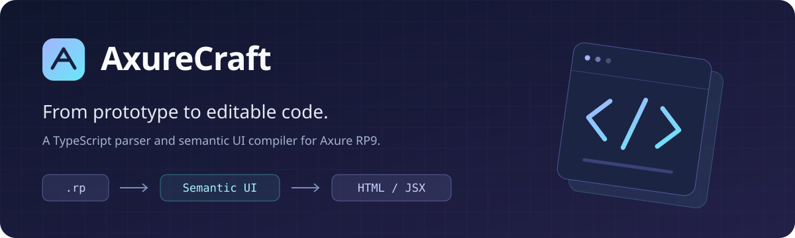
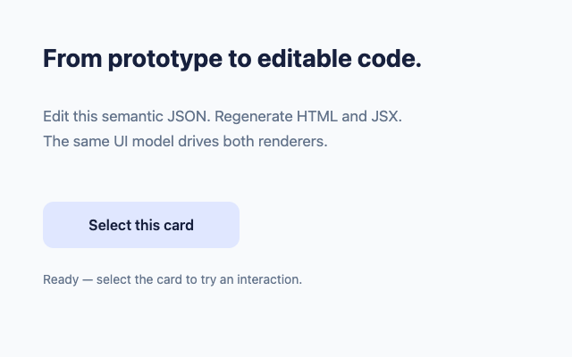
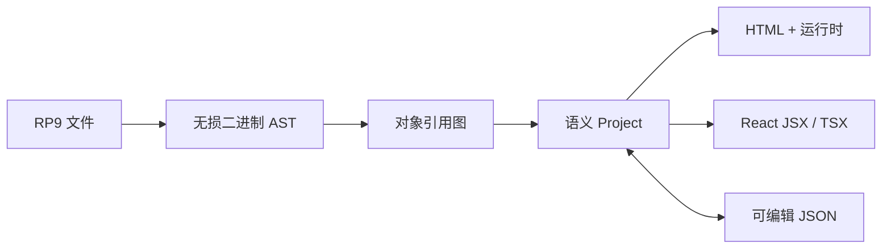

<div align="center">



**把 Axure RP9 原型，转换为可读、可改的 TypeScript 语义结构与 JSX。**

RP9 → Semantic UI → HTML · React JSX · TSX

[](https://github.com/renaesop/axurecraft/actions/workflows/ci.yml)


[](LICENSE)

[快速开始](#快速开始) · [语义结构](#语义结构) · [能力与边界](#能力与边界) · [验证](#验证) · [来源](#来源与许可)

</div>

AxureCraft 是一个 TypeScript 编写的 RP9 解析器和 UI 转换器。它读取 `.rp` 的对象、样式、资源与已支持的交互，生成可编辑的语义 JSON，再分别输出 HTML 和包含实际元素的 React JSX / TSX。

转换过程无需启动 Axure，也不依赖 C# API 或 .NET。生成的页面在浏览器中运行，React 工程可以独立构建。

> **实验阶段。** 已解析复杂校园 App 的 8 页、官方 RP9 Tour 的 2 页，并用 Webstack 的 RP9 源文件与配套原生 HTML 做截图对照（393 个展开控件、8 个中继器）。1920×3000 初始页面的精确像素差异降至 20 个像素（0.00035%），不代表所有原型或交互完全等价；未支持的功能写入 `conversion-report.json`。请先检查报告，再评估生成结果是否适用于你的原型。

## 快速开始

需要 Node.js **22.18+** 和 npm。在本项目目录执行：

```bash
npm ci

# 不需要 RP 文件：运行随项目提供的原创语义示例
npm run demo

# 转换你自己的 Axure RP9 文件
npm run convert -- ./prototype.rp ./output/prototype

# 修改语义 JSON 后，重新生成 HTML 与 React 工程
npm run generate -- ./output/prototype/project.json ./output/edited
```

直接打开 `output/demo/index.html`，或者转换结果中的 `index.html`。React 预览在相邻的 `react/index.html`。



*随项目提供的原创示例：点击卡片可切换外观和状态文本。*

`generate` 默认从 JSON 所在目录下的 `assets/` 读取资源；可用第三个位置参数指定资源的父目录。

```text
output/prototype/
├── index.html                 HTML 预览入口
├── page-*.html                各页的 HTML
├── project.json               可编辑的语义结构
├── conversion-report.json     未支持功能与转换统计
├── assets/                    按内容哈希复用的图片
├── source/project.ts          带类型的语义结构常量
└── react/
    ├── index.html             React 预览入口
    ├── package.json           独立工程的依赖与构建命令
    └── source/
        ├── Page1.jsx          具体、可编辑的 JSX 元素
        └── Page1.tsx          同一组件的 TypeScript 版本
```

将生成的 `react/` 目录复制到其他位置后，可以独立构建：

```bash
npm install
npm run build
npm run typecheck
```

## 语义结构



核心结构只有 `Project → Page → Widget`。控件保存几何、样式、结构化内容与行为；中继器保存模板和数据，动态面板保存状态页。`source` 单独保留原文件定位信息，便于回查转换问题。

| 字段 | 含义 |
| --- | --- |
| `x / y / width / height` | 相对父容器的几何位置 |
| `content` | 富文本、矢量路径、图片、表单控件 |
| `behaviors` | 事件与动作；条件和取值使用显式表达式树 |
| `variants` | 禁用、选中时的样式及可选替换内容 |
| `selectionGroup` | 互斥选中分组；中继器可通过 `isolateSelectionGroups` 按行隔离 |
| `children / states` | 分组成员、动态面板状态页 |
| `repeater` | 模板、列、行、绑定和布局 |
| `source` | RP 记录、对象编号、GUID 和原生类型 |

例如，改变一个文本节点并重新生成：

```ts
import { readFileSync } from 'node:fs';
import { parseRp9Semantic, emitProject } from './src/index.ts';

const { project, assets } = parseRp9Semantic(readFileSync('prototype.rp'));
const widget = project.pages[0].widgets.find(w => w.name === '标题');
const text = widget?.content.find(c => c.kind === 'text');

if (text?.paragraphs[0]?.runs[0]) {
  text.paragraphs[0].runs[0].text = 'Hello, AxureCraft';
}

await emitProject(project, assets, 'output/edited');
```

语义模型不保存 HTML 字符串。生成的 JSX 包含实际的 `<svg>`、`<path>`、`<span>` 和表单组件；表达式通过受限 AST 求值，不执行原型中的任意 JavaScript。

这里的“语义”是 UI 控件与行为的语义，不会自动推断商品卡片、登录表单等业务组件。无损 AST 与渲染模型各自独立；语义 JSON 不是完整 `.rp` 写回格式。

## 能力与边界

| 范围 | 当前支持 | 尚需补齐或验证 |
| --- | --- | --- |
| RP9 解析 | 容器、压缩、字符串表、对象引用、无损 payload AST | 未验证的格式变体；RP7 ZIP 明确拒绝 |
| 基础 UI | 绝对布局、富文本、图片、SVG、样式继承、基础表单、多选列表、自定义指示器、输入类型/长度/提示控制、连接线、树节点 | 精确字体度量、部分边框和箭头 |
| 表格与菜单 | 原生行列、单元格文本/边框/点击、轨道尺寸编辑、三级菜单悬停展开/关闭与原始定位 | 原生表格/菜单截图基准 |
| 容器 | 分组树、树节点展开折叠、动态面板、状态表达式/定时序列/状态推拉及自适应尺寸、固定定位/全宽、递归选中、嵌套母版/视图/覆盖/实例隔离 | 复杂组旋转/透明度、母版自定义事件 |
| 交互 | 页面/新窗口/框架跳转、移动/缩放/旋转、显隐/面板动画、推拉布局、灯箱/浮出层、带边界的拖动、滑动手势、焦点、行内链接 | 复杂动画、多条件组的原生时序 |
| 表达式 | 条件分支、文本/选中赋值、控件取值、算术与比较、日期/字符串方法、键盘/面板状态/拖动取值、全局变量读取/赋值和 URL 传值 | 更多函数与跨作用域引用；变量跨页回归仍需补齐 |
| 外观 | 禁用/选中/悬停/按下变体、容器鼠标样式传播、图片运行时状态切换、编辑值保留、独占选择组和单选组 | 容器外观、初始冲突选中状态的原生对照 |
| 中继器 | 模板、行数据、文本/图片绑定、排序、分页、筛选、增删改、标记行、条件加载、当前页行号、跨中继器控件批量赋值及选择组隔离 | 嵌套中继器及复杂加载/刷新时序 |
| 自适应视图 | 原生断点选择、父视图样式继承、位置/尺寸/绘制、手动/自动切换、保留表单节点和值 | 复杂表格/面板与自适应中继器布局的更多原生对照 |
| 页面快照 | 引用页面/母版内容、背景图、缩放/平移/裁切、预览显隐/状态/赋值、禁止快照内部交互 | 复杂预览脚本和原生截图基准 |
| 三方元件 | 保存为已支持 RP9 原生对象时走同一转换链 | 未逐库验证；外部网页、脚本和特殊对象需单独处理 |

无法解析的目标引用会保留诊断；依赖失效条件的分支组会被省略，避免猜测目标导致错误交互。并非所有尚未支持的行为都能仅靠报告穷尽，仍需要检查生成页面。

逐类审查结果与实现进度见 [控件审查](docs/control-review.md)。可运行 `npm run test:tables` 验证两种输出的表格交互、边界线和下拉选项。

## 验证

```bash
npm run typecheck
npm test
npm run demo
```

`npm test` 运行 58 项不依赖第三方资源的核心测试，覆盖二进制边界与往返、表达式和分组规则。

`npm run test:corpus` 另运行 41 项本地样本测试；`npm run test:all` 合并两组共 99 项。研究环境中的测试需要额外的 RP 样本、官方资源或历史输出，不包含在快速开始的前置条件中：

| 已执行的验证 | 证据范围 |
| --- | --- |
| 99 项单元/样本测试 | 解析、语义往返、JSX 编译、表达式、外观与输入边界 |
| 2,137 个官方二进制块往返 | payload 的 decode → JSON → encode 逐字节一致 |
| 2,000 次原生中继器函数对照 | 排序和分页的数据规则 |
| 3,100 次状态、14 次事件检查 | 启用/禁用及默认事件过滤 |
| 2,782 次表达式结果、14 次异常对照 | 支持的算术、比较、格式化和缺失值行为 |
| 800 次选中状态、800 次事件检查 | 禁用与选中缓存的交互规则 |
| 1,012 组选择操作 / 15,180 次控件状态检查 | 选择组、单选框、组/面板传播；逐操作核对事件顺序 |
| Webstack 原生 HTML 截图对照 | 393 个展开控件；首屏差异 10 / 1,440,000 像素，长页 20 / 5,760,000 像素 |
| 两种浏览器输出与独立构建 | 树、链接、图片、运动、推拉、灯箱/浮出层、键盘/手势、自适应、多选、指示器、中继器条件加载；独立 HTML 源码类型检查及 React 工程构建 |

上表为本地研究验证数据。[GitHub Actions CI](https://github.com/renaesop/axurecraft/actions/workflows/ci.yml) 会在 push / PR 时运行 Node.js 22.18 与 24 的类型检查和 58 项核心测试，以及 Chromium 中的 HTML/React 浏览器回归、导出 React 工程的独立安装/构建/类型检查及 HTML TypeScript 源码的独立类型检查。浏览器报告与截图保留 14 天；41 项本地语料测试仍需要未分发的研究样本。原生函数对照使用官方脚本及限定适配器，不能证明整个 Axure 运行时等价。HTML 与 React 的截图对比仍有少量像素差异，也不能代替原生截图对照。

**当前验收缺口：** 已取得小型 RP9 配对样例的原生 HTML 基准，三种宽度、两种状态的整页截图仅有 2–4 个角点差异像素；Webstack 复杂长页也完成配对：1440×1000 首屏差异 10 像素，1920×3000 长页差异 20 像素。另验证悬停、下拉菜单和滚动：1440×1000 固定标题栏滚动后为 0 差异像素，悬停为 42，菜单打开为 11；完整复杂交互仍需逐项补齐。39 个初始导航热点中心中有 4 个被上层元素遮挡，需与原生行为核对。完整 UI 等价目标尚未完成。

`npm run test:variables` 使用原创空文本控件验证 URL 变量赋值、选中内容替换及居中定位，覆盖 HTML 和 React。

选择组浏览器检查可用 `npm run test:selection-groups` 运行，使用原创语义夹具。需要本机 Chrome；可用 `CHROME_PATH` 指定路径。`npm run test:selection-groups-native` 则需要官方 RP9 脚本，可用 `AXURE_SCRIPT_DIRECTORY` 指定脚本目录（带末尾路径分隔符）。

两份 HTML 可直接截图比较：

```bash
node scripts/compare-html.mjs comparison.json output/comparison
```

`comparison.json` 指定原生页面与转换页面，例如：

```json
{
  "reference": "/path/to/axure-export/page.html",
  "candidate": "/path/to/converted/page-1.html",
  "viewports": [{ "width": 1280, "height": 900 }],
  "states": [{ "name": "initial", "hash": "" }]
}
```

输出 `index.html` 并排展示两张整页截图，附精确像素差异图及 `report.json`。支持本地文件和 HTTP 地址；两侧使用同一浏览器与窗口，不裁切、不设差异容差。

[Native HTML comparison](https://github.com/renaesop/axurecraft/actions/workflows/native-comparison.yml) 可在 Actions 页面手动运行。它下载固定提交的 Webstack 样例并校验 SHA-256，重新转换 RP，再对比两份 HTML；截图、差异图和转换诊断作为 artifact 保存。该工作流报告像素差异，不把非零差异判定为测试失败；页面脚本错误或图片加载失败会令任务失败。

本地可运行 `npm run test:ci`、`npm run test:ci:browser` 和 `npm run test:standalone`。浏览器脚本支持 `CHROME_PATH`；CI 安装 lockfile 对应的 Playwright Chromium，不依赖本机 Chrome 路径。`test:standalone` 需要先生成 `output/demo/react`（例如运行 `npm run demo`）。

配对样例、截图指标和复现步骤见 [原生 HTML 对照](docs/native-comparison.md)。

完整的本地验证过程与限制见 [研究说明](README.txt)。

## 代码导航

```text
src/
├── parser/             RP9 容器与无损 payload AST
├── graph.ts            原生对象与引用解析
├── model.ts            语义数据结构
├── convert.ts          原生对象图 → 语义 UI
├── semantic.ts         语义 JSON 边界校验
├── styles.ts           原生样式解释
├── native-expression.ts / expression*.ts
├── repeater*.ts        中继器数据、模板、排序与分页
├── widget-state.ts     共享控件状态规则
├── selection.ts        选择组、单选组及容器选中传播
├── behavior-runtime.ts 共享动作执行
├── html.ts / jsx.ts    两种输出生成器
├── runtime.ts          HTML 交互运行时
└── react-runtime.tsx   React 交互运行时
```

公共入口为 [`src/index.ts`](src/index.ts)。优先阅读 [`model.ts`](src/model.ts)，再沿 `convert → emitProject` 查看转换链。

贡献新的控件或行为时，请同时提供来源字段说明、可分享的最小样例，以及 HTML / React 两条链路的验证。请区分原始 RP、人工修正的语义夹具和真正的原生输出。

## 来源与许可

AxureCraft 的代码采用 [MIT License](LICENSE)。上游代码归属与第三方材料边界见 [THIRD_PARTY_NOTICES.md](THIRD_PARTY_NOTICES.md)。

- payload 协议实现参考 [LilZeeCN/zee-rp](https://github.com/LilZeeCN/zee-rp)，固定提交 `b3a6709382fe57fba59bd744687e633229a1ec71`，保留 MIT 署名。
- 逆向研究使用 [REA](https://github.com/morluto/rea) 方法和官方 Axure RP9 安装包 / C# API 进行结构验证；转换器不依赖它们运行。
- 复杂样本来自 [SouthAki/GKD-applicationUI-Design](https://github.com/SouthAki/GKD-applicationUI-Design)，固定提交 `82520f05cd8f0f84dad28ff152ccad90fcfa4356`，原仓库为 GPL-3.0。样本及其图像不属于本项目原创 MIT 内容。
- `examples/hello.project.json` 是为本项目编写的原创语义示例，可直接运行。

AxureCraft 是独立项目，与 Axure Software Solutions 无隶属关系。
