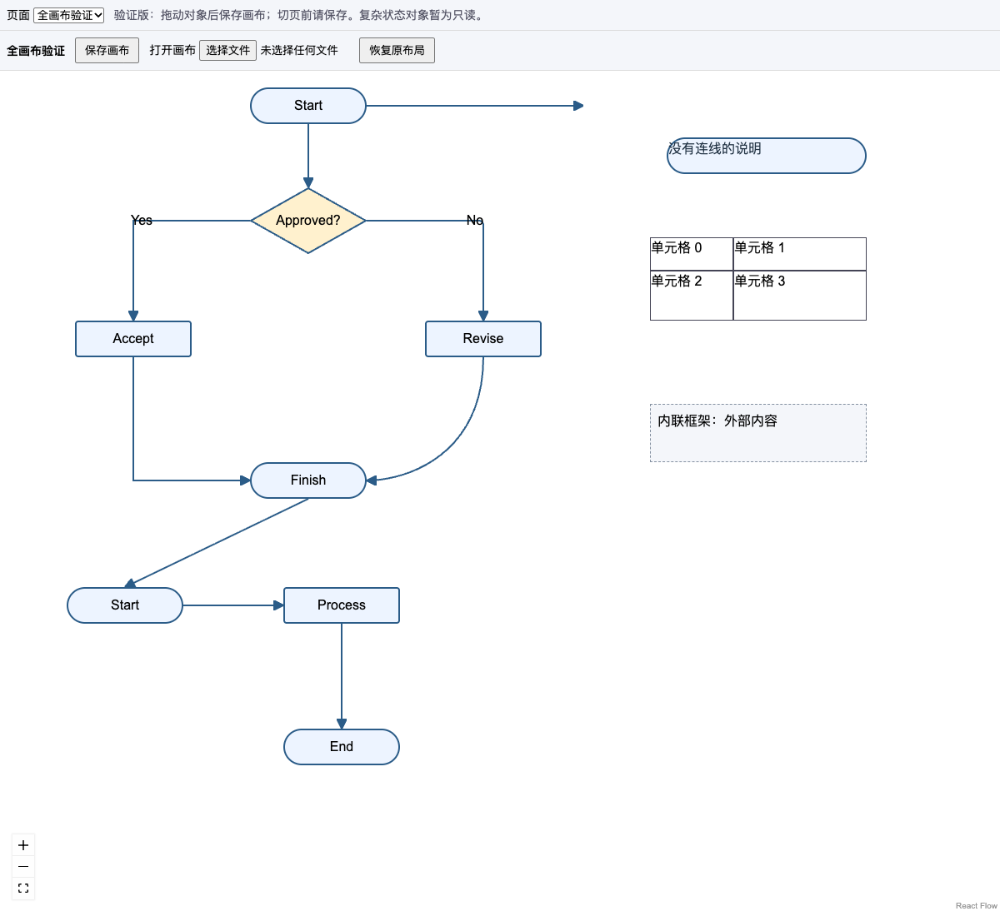

# React 画布验证版（#16 第一阶段）

本入口把整个页面作为画布，使用 React Flow 的节点、分组和视口交互。文字、图片、控件、表格及无连接的对象仍保留；连接线使用自定义 React edge，复用原有 SVG、箭头和标签，不交给默认路由器重新排版。它是可运行的第一阶段验证，不替换现有 HTML / React 原型。



## 运行

```bash
npm ci
npx tsx scripts/validate-flow-canvas.ts
```

打开 `output/flow-canvas-check/index.html`。原创用例包含分支、曲线、分组、跨组连接、自由端点、孤立文字和四个表格单元格，另有通过 RP9 二进制解析器生成的原生标签用例。所有夹具均在 `tests/fixtures/`，浏览器验证不下载样本或访问 CDN。

对自己的原型，先转换，再生成画布：

```bash
npm run convert -- prototype.rp output/prototype
npx tsx src/flow-canvas-export.ts output/prototype/project.json output/prototype/canvas
```

打开 `output/prototype/canvas/index.html`。图片资源从输入 JSON 所在目录读取并复制。入口包含全部页面，切换页面前请保存修改。生成的 JS、CSS、资源在本地，无需在线编辑器或服务端渲染。

## 本阶段支持什么

- 保留初始位置、大小、来源、对象身份、父子关系和绘制顺序；图形与文字是实际 React DOM/SVG 组件。
- 拖动普通节点、孤立对象、表格整体或分组；平移不会改变节点端口标识或吸附相对位置。
- 保留手工中间拐点，只重接末端两段。无拐点的正交线需要时增加折点，避免斜线。曲线控制柄随对应端点移动；自环两端一起移动。
- 组内连线的父容器局部几何不变；跨组连接调整相应端点。自由端点不自动吸附，停在其父容器内的原坐标。
- “保存画布”下载 JSON；刷新后用“打开画布”恢复。“恢复原布局”清除当前页面的移动。
- 编辑模式不执行原型的点击、拖动或其他业务行为；表单在画布中展示外观；外部内联框架显示占位，不加载远程内容。

目前不提供文字编辑、端口改接、增删拐点、表格轨道调整、对象增删及语义模型回写。这些仍属于 #16 的后续验收项。含动态状态、自适应、外观变体或固定定位的对象暂不可直接移动；复杂容器使用初始静态内容，不能据此宣称所有 RP9 动态布局等价。旧 JSON 没有结构化连线几何时仍能显示，但移动受影响节点会明确提示重新转换，不保留一条脱离节点的旧 SVG。

## 数据和几何

`connection.geometry` 是可选新增字段，坐标相对连线父容器：

```ts
{
  space: 'parent',
  start: {x, y}, end: {x, y},
  points: [{x, y}],       // 中间拐点，不含首尾
  controls: [{x, y}, {x, y}], // 曲线控制柄，可选
  label: {x, y}          // 初始原生标签中心，可选
}
```

原生解析阶段保留实际重接后的端点、拐点、控制柄和标签位置，分组重建时同步转换坐标。原有 SVG 字段仍保留以兼容旧渲染链路；画布中的修改由结构化几何派生 SVG 和文本面板位置。第一阶段没有全局迁移“只保存结构化几何”的格式。

拖动始终相对不可变原始页面计算，避免连续鼠标移动积累拐点漂移。父链坐标用于组内/跨组换算；原始目标/端口引用始终保留。渲染库为自由端点使用的不可见锚点不会写入保存文档。

画布文档 `axurecraft-canvas@1` 包含 `sourceSha256`、`pageId`、原始页面的精确序列化快照及按 Widget ID 记录的位置。基线任一字段变化都拒绝恢复，这是保守冲突策略，尚不尝试合并新版本 RP。文件不会覆盖 `project.json`；未修改对象及来源保留在原始模型，移动结果可以由 `moveCanvas` 重建。

## 回归

```bash
npm run test:ci
npx tsx scripts/validate-flow-canvas.ts
npm run test:ci:browser
npm run audit:structure
npm run test:standalone
```

模型测试覆盖原生几何/既有 SVG 一致性、JSON 校验、整页对象保留、末端重接、分组/跨组/自由端点、自环、保存恢复、冲突和旧模型处理。浏览器脚本实际拖动节点、分组、孤立文字与表格，检查端点偏差小于 0.75 px、原生标签、真实 React 组件、下载后刷新重开及重复保存一致性。报告和截图位于 `output/flow-canvas-check/`。

这套原创夹具是公开的对照基线；没有读取或验证 issue 作者不能公开的内部原型，也尚未与 draw.io 做同页编辑对比。
