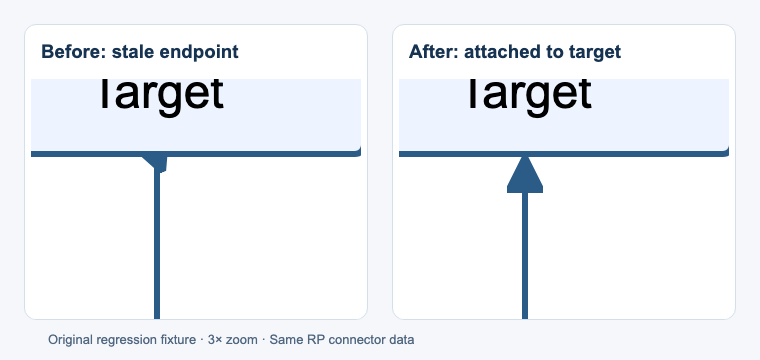

# 真实 RP9 流程连线：端点与截图验证

三份公开 RP9 共 **243 个控件、38 条连接线、60 个已吸附端点**。除了检查节点引用和两种输出的截图，还直接测量浏览器中 SVG 路径端点到目标控件连接点的距离。两个渲染器画出同一个错误，仍会令端点检查失败。

原始 RP 和作者图片不随仓库分发。下载 URL、SHA-256 和预期计数见 [flow-samples.json](../examples/flow-samples.json)。

| 文件与来源 | 控件 | 连线 | 已吸附端点 | 过期端点缓存 |
| --- | ---: | ---: | ---: | ---: |
| [Axure9_ConnectorLines_Bug-01.rp](https://forum.axure.com/t/bug-connector-line-issues/63835) | 62 | 29 | 42 | 9 |
| [1.rp：Connector tool bugs in the latest update](https://forum.axure.com/t/connector-tool-bugs-in-the-latest-update/56065) | 175 | 6 | 12 | 1 |
| [Connector issue.rp：Connectors break when items moved](https://forum.axure.com/t/connectors-break-when-items-moved/68632) | 6 | 3 | 6 | 0 |

第一份是规格标注图，第二份是住宿评价表单的跨屏流程，第三份包含三个节点、水平连接及绕行连接，覆盖分支与汇合。第三份保存下来的静态几何是正常的：帖子讨论的编辑器拖动故障不能当作转换器已复现的问题。第一份另外有 16 个自由端点，转换后仍然自由，不会按距离猜测并强行吸附。三份均无悬空引用、转换诊断和作者设置的控件交互。

## 本轮修复

**已吸附端点读取了过期缓存。** 原实现直接使用 `LOCATION` 和 `end-point-x/y`。官方 RP9 程序集的 `Connector.StartPoint` / `EndPoint` 实际优先查找目标控件的连接点，将归一化坐标映射到旋转后的控件矩形，再按页面整数坐标取整；只有未能解析连接点时才回退到保存的坐标。

现在转换器采用相同的端点解析规则，包含默认四个连接点、`ConnectorPoints` 中的自定义或移动过的连接点、旋转及负坐标的取整。显式连接点字典会替代默认值，删除的默认连接点不会被重新创建；自定义坐标允许超出 0～1。目标样式使用当前自适应视图。语义文件仍保留节点与端口 ID，二进制 AST 不被改写。

本轮纠正公开样本中的 10 个过期端点，最大缓存偏移 **7.071 px**。第二份样本的一个终点从缓存 `(1102,997)` 回到目标底部连接点 `(1100,992)`，纠正 **5.385 px** 的偏移。


另外加入 [issue #3](https://github.com/renaesop/axurecraft/issues/3) 提供的坐标回归：实际端点 `(1412,2896)` → `(1412,2919)`，缓存终点却是 `(798,1914)`。圆角与正交两种类型现在都输出 `M 0 0 L 0 23`，不会再追加跨越页面的斜线。这是根据报告数据构造的测试，未取得该内部原型，不能据此声称已验证其中全部 244 条连线。

**最后一段被当成额外拐点。** 原实现先画到最后一个 segment 的 `ToPoint`，再追加缓存终点，导致小回折和错误箭头朝向。原生 `GetSegmentPoints` 只保留中间段的 `ToPoint`，末点使用已解析的 `EndPoint`。现在替换末点，并调整首尾折线的对齐，保留中间绕行路径；单段正交连接发生错位时补充直角折返。

下面是根据该问题制作的原创回归图，使用同一组原始连接数据，左侧为修复前解析器输出，右侧为修复后输出。旧代码会令最初新增的五项单元测试中的三项失败；随后补充了 issue #3 的坐标回归。



**细长 SVG 在缩放时脱开。** 2×310 px 的连接线在 110% CSS 缩放时，浏览器会分别舍入两个方向的布局尺寸。默认 `xMidYMid meet` 用较小的缩放比例缩放整条路径，产生端点空隙。Connector 现在输出 `preserveAspectRatio="none"`，使两个轴分别匹配绘制区域；普通图形保持原设置。浏览器回归会临时恢复旧设置，确认能够检测到大于 0.75 px 的偏移，再验证修复后的距离小于 0.05 px。

## 验证结果

固定 1920×1000 浏览器窗口，拍摄完整页面。100% / 110% CSS 缩放与 1× / 2× 像素密度独立组合，每组分别生成 HTML 和 React 截图。

| 样本 | 截图对照组数 | HTML / React 差异像素 | 最大端点距离（页面 px） |
| --- | ---: | ---: | ---: |
| Connector Lines | 4 | 每组 0 | 0.512 |
| Connector Zoom | 4 | 每组 0 | 0.500 |
| Connector Move | 4 | 每组 0 | 0.015 |

60 个已吸附端点在两种渲染器及四种环境中共检查 **480 次**。原生规则会将连接点取整到页面整数，理论上相对精确几何连接点最多偏移 `√(0.5²+0.5²)`，断言另允许 0.05 px 的浏览器布局舍入。报告保存每个端点、目标 ID、实际坐标、期望坐标和距离，不只保存一个通过标志。

截图检查固定关闭 GPU 栅格化：本机 GPU 下，内嵌 SVG 图片曾出现 17 个大于一个色阶的差异像素；软件渲染下这 12 组精确一致。没有扩大像素差异阈值来掩盖该现象。原创流程图浏览器测试仍使用普通浏览器启动方式，并覆盖分支、汇合、回路、泳道、重复母版实例、端点圆环和细长连线缩放。7 页原创用例的 HTML / React 截图均一致。

每条连接线还沿路径取样确认实际着色，检查资源引用唯一、图片加载、浏览器错误及 67 个二进制记录的 decode → JSON → encode 逐字节往返。自定义端口、旋转、负坐标、自由/未知端口、曲线和缓存不变性有独立单元测试。

以上规则依据本地官方 RP9 C# 程序集的只读 CIL 检查，关键入口为 `Connector.get_StartPoint`、`get_EndPoint`、`GetSegmentPoints`、`ConnectorPoint` 默认 GUID 和 `DrawingFunctions.OffsetTopLeft`。**这些文件尚无配对的原生导出 HTML**，所以截图数据比较的是两个转换渲染器，不能称为与原生 Axure 像素等价。自动重连发生在 RP 转换阶段；编辑生成页面或运行时移动节点后的自动布线仍不在本轮范围内。

## 前一轮已修复

- RP9 容器中保留的 RP8 导出配置记录被拒绝：允许已验证的两种内部头，外层仍要求 RP9。
- React 半透明背景绘制两次：改为文档背景只绘制一次，包含自适应视图切换。
- 原生类型 18/19 的实心/空心圆端点缺失：保留原生页面单位尺寸，空心内部不露出线身。
- 图片边框 CSS 变量导致独立 TSX 类型检查失败：允许 `--` 开头的 CSS 属性，仍检查普通属性拼写。

## 复现与 CI

```bash
# 下载固定来源、校验哈希、转换、端点距离检查和截图比较
npm run test:flow-samples -- --download

# 已有 connector-lines.rp、connector-zoom.rp、connector-move.rp 时
npm run test:flow-samples -- research/flow-more

# 不依赖第三方文件的单元与浏览器回归
npm run test:ci
npm run test:flow
```

浏览器可用 `CHROME_PATH` 指定。结果在 `output/flow-samples/`，包括 HTML/React 导出、截图、转换报告与逐端点 `validation.json`。

[Public RP9 flow samples](https://github.com/renaesop/axurecraft/actions/workflows/flow-samples.yml) 手动运行三份固定样本，并在仓库外分别安装、构建和检查生成工程。截图与报告保留 14 天。原创端点及缩放回归随主 CI 在每次 push / PR 执行。
