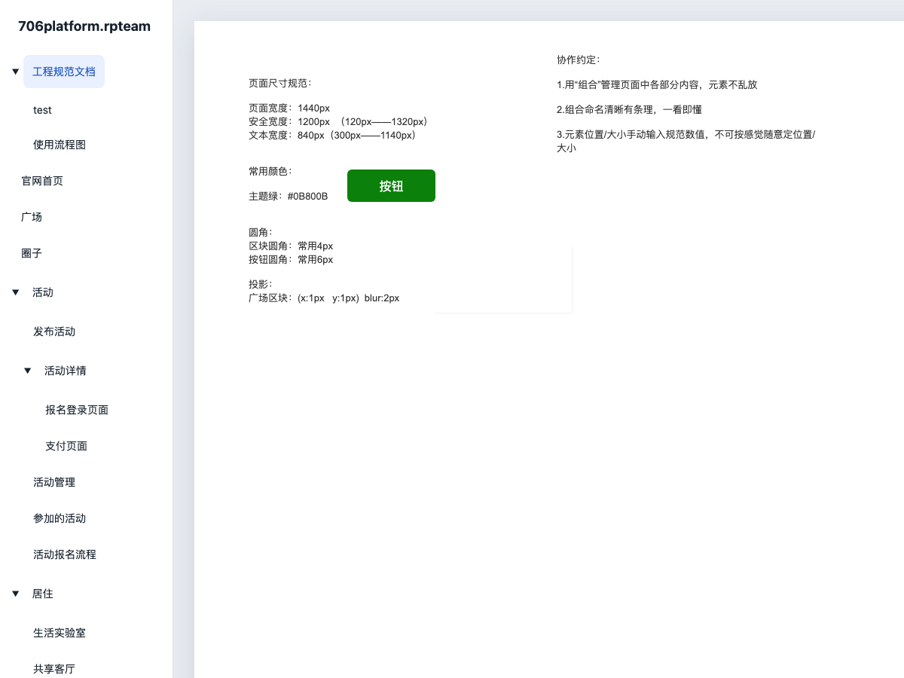
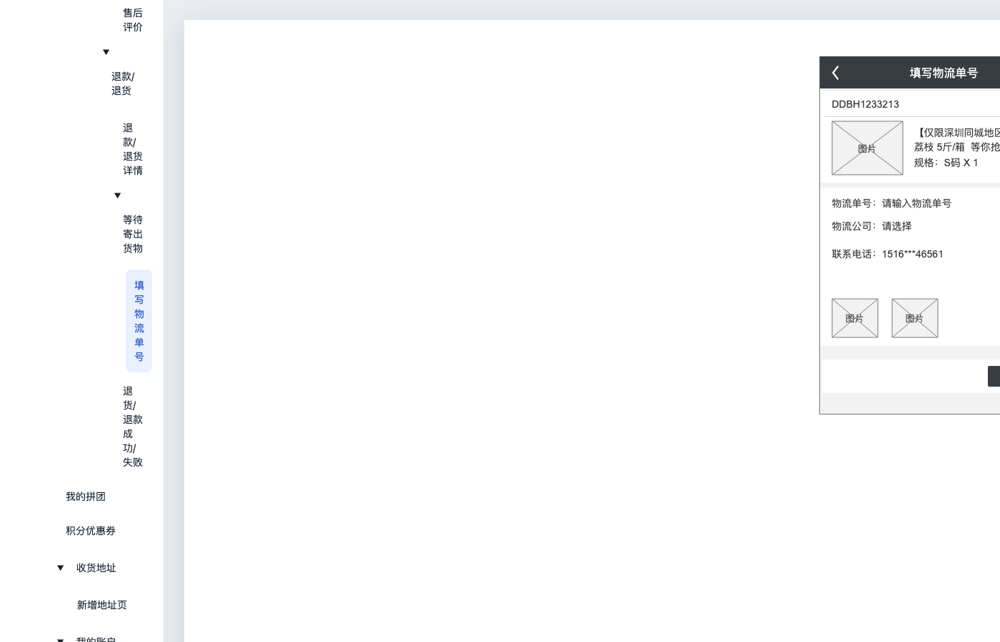
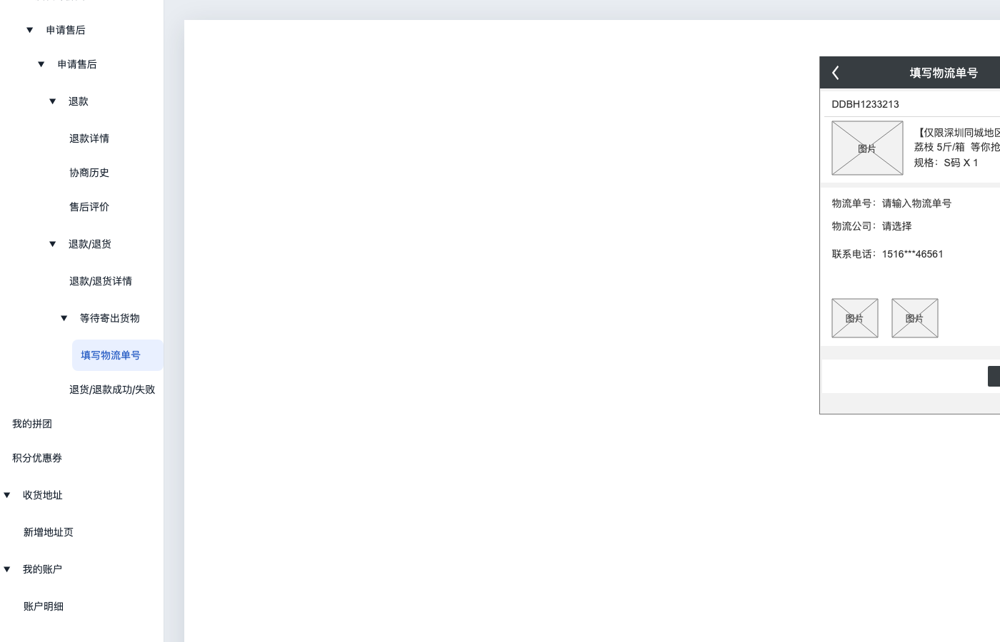

# 页面目录的层级与顺序

Issue #12 在主分支 `ee5ba11` 上可用已收录样本 `tests/fixtures/rpteam/706platform.rpteam` 复现：输出按容器记录顺序从“官网首页”开始，25 个页面全部平铺。原生 sitemap 实际从“工程规范文档”开始，存在三级页面及“弃用版本”文件夹。

`DesignDocument.sitemap` 指向 `Axure:SiteTreeMap`。其中 `tree` 的 `children` 列表定义根节点顺序，`Axure:Node.children` 定义子节点顺序，`node-table` 把节点映射到页面包 GUID 或 `Axure:MasterTreeFolder`。转换现在保留此结构到可选的 `Project.pageTree`；HTML 和 React 入口共享同一目录展示，初始页面为树中首个页面。

页面文件名、页面 GUID 和已有交互链接保持其原始映射。同名页面通过 GUID 区分，目录文件夹仅用于组织，不生成虚假页面。部分团队快照的页面记录未出现在保存的 sitemap 中，这些页面追加到目录末尾，不推测父节点。无 sitemap 的旧语义 JSON 继续按 pages 数组生成平铺目录。

损坏或重复的原生树节点会报告 `page-directory` 诊断，并保留其他可用页面。语义 JSON 的 pageTree 验证引用、节点唯一性、页面覆盖和深度，防止目录跳转到不存在的页面。

## 浏览器截图

修复前，页面平铺且从“官网首页”开始：


修复后，恢复原生层级和首个页面：



## 回归验证

```bash
npm run test:ci
npx --no-install tsx scripts/validate-page-directory.ts
node scripts/validate-standalone.mjs output/page-directory-check/authored/react
```

`tests/fixtures/page-directory.ts` 生成 `.rp` 与 `.rpteam` 原生编码夹具，故意使记录顺序与目录顺序不同，包含子页面、同名页面、文件夹及未收录页面。三项初始目录回归在修复前失败；真实样本直接使用仓库已有二进制文件及其校验和。

浏览器回归检查两个样本的 HTML/React 入口：目录顶层顺序、三级子页面、默认页面、同名页面的独立目标、选中状态和文件夹展开/折叠。截图及报告写入 `output/page-directory-check/`。

## React DevTools 的独立调查

Issue #13 单独跟踪 React 入口审查。此次以 DevTools renderer hook 探针检查 `react/index.html`，顶层静态容器没有 React renderer，但子 iframe 已注册 `react-dom 19.3.1`，并提交包含 `Page1`、`PrototypePage`、`RpWidget` 的组件树；直接打开 React 子页同样可检测。尚未用浏览器扩展 UI 复现用户的全部操作，因此不将其描述为所有 React 页面均不支持 DevTools。目录修复不关闭 #13。

## 175 页、11 层的公开 RP 样本

后续按用户要求联网补充了 `tests/fixtures/rp/b2c-platform.rp`：公开的“B2C通用电商平台原型设计【商城App 后台PC】”，原始文件来自 [thiszhangyong/axureresource](https://github.com/thiszhangyong/axureresource)。来源文件链接、固定提交和 SHA-256 见 `tests/fixtures/rp/b2c-source.json`。二进制未经改动，测试不需要联网。

该样本有 175 页、68 个文件夹、243 个目录节点，最深 11 层。容器记录首项是“收货地址”，原生目录首项是“电商平台框架图”。额外下载筛选的房源租赁样本有 188 页、67 个文件夹、7 层，ERP 样本有 107 页、10 个文件夹、4 层；本轮选择层级最深的电商样本进入固定回归。

`b2c-directory.json` 是独立读取原生 `SiteTreeMap` 和 `PackageInfos` 后冻结的完整顺序表，生成时不调用转换器或目录转换函数。单元测试及浏览器测试都逐项核对全部 243 个节点的深度、名称和页面 GUID，并检查第 11 层“填写物流单号”的真实跳转、同名“收货地址”的独立跳转及键盘折叠/展开。

大样本还暴露了侧栏宽度不足时深层标签逐字换行的问题：“填写物流单号”被拆成 6 行。新增断言在修复前失败。目录现保持单行文字，内容过宽时在固定宽度侧栏内横向滚动，保留各层缩进。





```bash
npx --no-install tsx scripts/validate-large-page-directory.ts
node scripts/validate-standalone.mjs output/large-page-directory-check/react
```

检查结果及截图位于 `output/large-page-directory-check/`。该样本另有 15 条既有非目录转换诊断；目录验证通过不代表页面内容、交互均与 Axure 原生输出等价。
