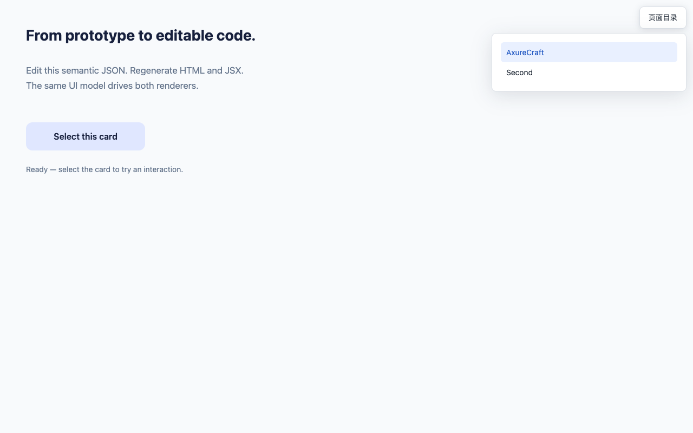

# 可审查的 React 预览入口

Issue #13 的旧入口 `react/index.html` 是复制的静态 HTML 目录，通过 iframe 加载原型。子页本身能注册 React renderer，但顶层文档没有原型的 React root，入口上的组件审查依赖子 frame 和扩展权限。

现在 `react/index.html` 直接挂载 `PrototypePreview → PageN → PrototypePage → RpWidget`。目录作为可收起的浮层显示，不给原型增加坐标偏移；HTML 入口提供“React 预览”链接。目录使用 `?page=page-N.html` 选择页面，保留刷新、前进/后退和浏览器原生链接操作。未知页面参数回退到目录中的首个页面。

单独打开 `react/page-N.html` 仍只显示对应原型，不增加目录浮层。原型内的导航行为仍使用已有页面文件地址。所有入口均可使用同一套 React 组件和 source map；生成的代码不伪造或替换 DevTools hook。



## 使用方法

安装 [React Developer Tools 官方扩展](https://react.dev/learn/react-developer-tools)，重新转换原型，打开输出目录的 `react/index.html`，在浏览器开发者工具的 Components 中查看 `PrototypePreview` 和原型组件。

如果浏览器不允许扩展读取本地文件，可从输出目录启动本地 HTTP 服务后访问 React 入口：

```bash
python3 -m http.server 8000 --bind 127.0.0.1 --directory output/demo
```

然后访问 `http://127.0.0.1:8000/react/index.html`。HTML 输出仍为普通 DOM，组件审查使用 React 入口。

## 回归和验证边界

```bash
npm run test:ci
npx --no-install tsx scripts/validate-react-devtools.ts
npx --no-install tsx scripts/validate-page-directory.ts
npx --no-install tsx scripts/validate-large-page-directory.ts
node scripts/validate-standalone.mjs output/react-devtools-check/react
```

旧入口上的“顶层无 iframe”断言先失败。修复后，DevTools 回归分别在 `file://` 和本地 HTTP 下检查：

- 在页面脚本执行前安装仅存在于测试中的 hook，接收实际 React renderer 注册和 Fiber root commit。
- 从顶层 root 读取 `PrototypePage`、`RpWidget` 等组件，并通过 renderer 的 `overrideProps` 修改实际组件属性。
- 通过 renderer 的 `overrideHookState` 隐藏和恢复目录，验证真实 DOM 更新；恢复由同一 DevTools 接口完成。
- 验证原型控件交互、目录控件不触发页面 click 行为、原型坐标保持原值、目录切页、刷新、前进/后退、非法查询回退及独立页面入口。
- 保留已有目录断言，继续核对真实 175 页样本全部 243 个节点、11 层层级、同名页面及最深页面跳转。

报告位于 `output/react-devtools-check/validation.json`。这些测试验证 React 与 DevTools 的 renderer 协议及编辑入口，不等同于对每种浏览器扩展版本的 Components/Profiler 界面做了 GUI 自动化测试。目录样本的既有非目录转换诊断不在本 issue 的修复范围内。
