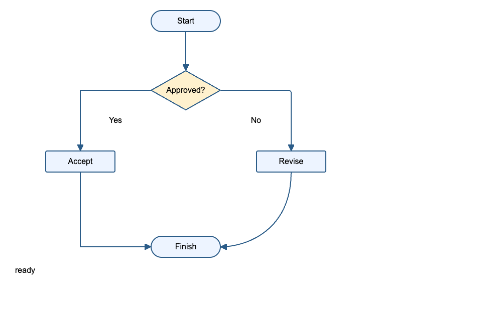

# 生成结构的可编辑性检查

用例同时检查编辑位置、模板复用、层级和行为表达方式。字节数用于定位重复数据；这些指标不能单独给出通用的“可读性分数”。固定运行时库与每页组件分别统计，截图和交互由浏览器回归验证。

## 六组原创用例

| 用例 | 要检查的结构 | 自动验收 |
| --- | --- | --- |
| 单段纯文本 | 一个控件、一个文本组件，直接可见文案 | 1 个 `RpWidget`、1 个 `RpText` |
| 四种混排文本 | 相同段落内保留独立文字片段和样式 | 修改一个片段的文字只改变一行 JSX |
| 动态富文本 | 文案、样式、变量含义可以分别修改 | `set-rich-text` + `paragraphs/runs` + 表达式树 |
| 3×2 表格 | 行、列、单元格可定位 | 3 个 row、6 个 TableCell |
| 1 / 100 / 1000 行中继器 | 行数据与模板各保存一份 | 数据行数变化时组件主体完全相同；零份展开行元数据 |
| 双状态面板 | 状态内容能直接阅读和修改 | 2 个显式 `RpState` |

测试位置：[structure.test.ts](../tests/structure.test.ts)，原创输入：[structure.ts](../tests/fixtures/structure.ts)。这些输入不依赖 Axure 安装和第三方 RP 文件。

## 流程图：四组结构用例

流程图同时检查节点、连线引用和容器层级。连线方向不能只从 SVG 路径反推；生成的 `project.json`、`source/project.ts` 和 React 页面定义均保留 `connection`。节点文字仍是独立的文本片段，修改文案只改变一行 JSX，连接关系保持不变。

| 用例 | 节点 / 连线 | 结构验收 | 绘制验收 |
| --- | ---: | --- | --- |
| 顺序流程 | 3 / 2 | 每个端点指向存在的节点 | 水平、垂直线及箭头可见，点击触发对应事件 |
| 分支与汇合 | 5 / 5 | 1 个分支、1 个汇合，无环 | 直线、折线、圆角折线、曲线及 Yes / No 标签 |
| 回路与自环 | 3 / 4 | 正确识别有环；节点只声明一次 | 虚线回路、自环曲线、双箭头 |
| 双泳道 | 4 / 3 | 节点归属两个组，跨组端点可解析 | 泳道层级、跨泳道连接和文字 |

这些用例没有栅格图、画布或嵌入页面。额外的浏览器用例复制两份流程到独立母版实例，验证 SVG 标记 ID 隔离；单元测试检查母版和中继器复制后的端点引用。另有圆形端点/半透明背景页，检查空心端点内无残留线身、实例裁切引用和背景只绘制一次。另有过期缓存端点和细长连线缩放回归，直接测量路径到节点的距离。共 7 页的 HTML / React 整页截图均为 0 个差异像素。



生成结构中的连接关系示例：

```ts
connection: {
  routing: 'orthogonal',
  start: { target: 'check', port: 'source-port-guid' },
  end: { target: 'accept', port: 'destination-port-guid' }
}
```

端点 `target` 是控件 ID，`port` 是原生连接点身份。未吸附端点允许没有 `target`；引用了不存在节点的端点另列为 `danglingTargets`，旧模型中没有拓扑信息的 Connector 列为 `missingMetadata`。不会根据名称、位置或路径相交猜测连接。

`flowStructure()` 在模板层统计节点、边、分支、汇合、回路和路由类型。节点数只包括被连线引用的控件，不包括孤立图形或泳道背景；面板各状态与中继器模板各遍历一次，报告不是当前可见状态的运行时图。环检测使用入度和队列，连接线不会把输出树递归展开。

4 个用例的组件主体分别为 54 / 119 / 87 / 108 行；回路仍有 7 个 `RpWidget` 声明，对应 3 个节点和 4 条边。泳道的容器与背景单独计入控件，报告会高于业务节点数。代码包含显式 SVG 路径；目前不会自动提炼成业务流程组件。修改端点引用也不会自动重算路径，编辑器的自动布线/拖动吸附尚未实现。

实现：[flow.ts](../src/flow.ts)，原创输入：[flow.ts](../tests/fixtures/flow.ts)，结构断言：[flow.test.ts](../tests/flow.test.ts)，浏览器检查：[validate-flow.ts](../scripts/validate-flow.ts)。官方 Flow 元件库与 RP9 Tour 的研究结果见[控件审查](control-review.md#流程图与连接关系)。这些结果尚不能证明与原生 Axure 流程图截图等价。

后续三份公开 RP9 共 243 个控件、38 条连接线，发现并修复过期端点缓存、末端多余回折、缩放造成的 SVG 留白，以及混合版本记录拒绝、圆形端点缺失和 React 半透明背景重复绘制。详见[真实连线样本验证](flow-samples.md)，包括缩放、像素密度、精确差异与下载复现方法。

## 已找到并消除的重复

中继器原先在模板、数据以外，还将所有展开行的控件状态写入页面定义。React 运行时本来就能根据模板构造这些状态，因此删除导出时的重复副本，在首次挂载时计算初始禁用和选中状态。

| 输入 | 修改前 TSX 字节 | 修改后 TSX 字节 | 展开行元数据 |
| --- | ---: | ---: | ---: |
| 100 行 | 80,559 | 20,501 | 100 → 0 |
| 1000 行 | 782,498 | 178,001 | 1000 → 0 |

1000 行用例减少 77.3%。组件主体均为 16 行、745 字节，只有一份行模板；数据区随行数增长。浏览器回归额外检查初始禁用/选中、ItemLoad 富文本、逐行数据绑定和批量赋值。

## 运行方法

```bash
# 六组基础结构用例 + 四组流程图 + 1000 行中继器
# 输出 output/structure-audit.json
npm run audit:structure

# 检查任意已经转换的语义项目
npm run audit:structure -- output/my-project/project.json output/my-structure.json

# 结构断言与富文本交互 / 截图检查
npm test
npm run test:rich-text
npm run test:flow
```

报告包含语义数据字节数、完整 TSX 字节数、组件主体字节/行数、控件声明数、模板数、重复行元数据、缩进深度和不透明 HTML 注入检查；有连接线的页面另附拓扑报告。GitHub Actions 执行结构断言，并保存报告、富文本及流程图截图。

## 富文本的可编辑形式

```ts
{
  kind: 'set-rich-text',
  target: 'total-label',
  richText: {
    kind: 'text',
    css: {},
    paragraphs: [{
      css: { 'text-align': 'right' },
      runs: [
        { text: 'Total: ', css: {} },
        {
          text: '',
          css: { 'font-weight': '700', color: '#c20' },
          expression: { kind: 'variable', name: 'total' }
        }
      ]
    }]
  }
}
```

表达式结果按文字渲染，HTML 特殊字符保持原值。转换层负责解析原生 `RichTextLiteral`，执行层求值，HTML/React 共用段落与片段结构。跨片段公式、母版/中继器引用和快照预览也走同一语义模型。

后续仍应增加重复母版的组件复用、复杂自适应外观、深层容器和多人编辑任务的评估。当前用例没有证明业务组件已经自动抽象完成。
